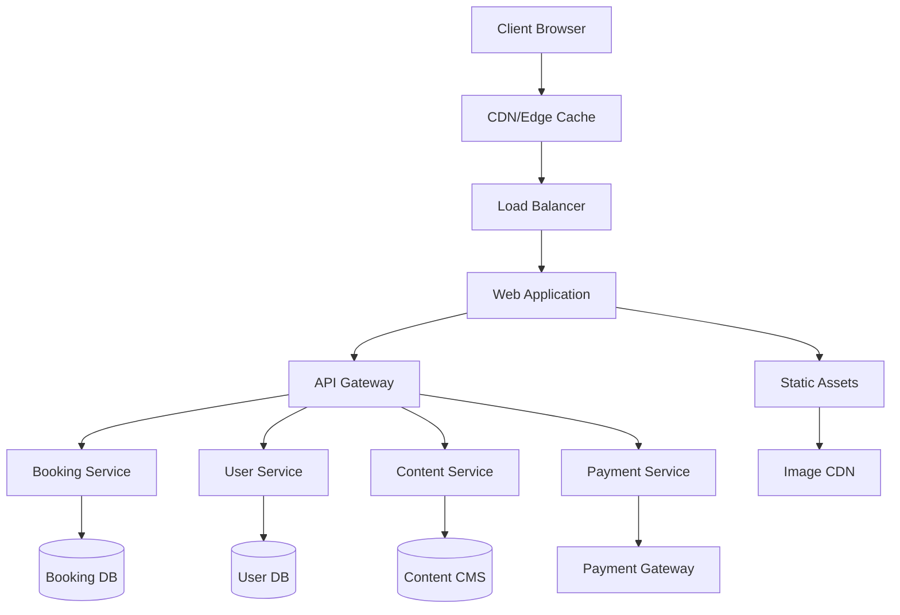

# System Architecture

## Overview

The LÖTUS Pilates retreat platform follows a modern, scalable architecture designed for high performance, security, and maintainability. The system is built using a microservices approach with clear separation of concerns.

## Architecture Diagram



## Frontend Architecture

### Technology Stack

- **Framework**: Next.js 14 with App Router
- **Styling**: Tailwind CSS with custom design system
- **State Management**: Zustand for client state, React Query for server state
- **UI Components**: Custom component library built on Radix UI primitives
- **Animations**: Framer Motion for smooth transitions and micro-interactions
- **Forms**: React Hook Form with Zod validation
- **Testing**: Jest, React Testing Library, Playwright for E2E

### Component Structure

```
src/
├── components/
│   ├── ui/              # Base UI components
│   ├── landing/         # Landing page specific components
│   ├── booking/         # Booking flow components
│   └── shared/          # Shared business components
├── app/
│   ├── (marketing)/     # Marketing pages
│   ├── (booking)/       # Booking flow pages
│   └── (dashboard)/     # User dashboard
├── lib/
│   ├── api/            # API client functions
│   ├── utils/          # Utility functions
│   └── stores/         # State management
└── styles/
    ├── globals.css     # Global styles
    └── components.css  # Component-specific styles
```

## Backend Architecture

### Microservices

#### 1. User Service
- User registration and authentication
- Profile management
- Preferences and settings
- JWT token management

#### 2. Booking Service
- Retreat availability management
- Reservation creation and modification
- Booking status tracking
- Waitlist management

#### 3. Content Service
- Retreat information management
- Media asset handling
- Blog and content delivery
- SEO metadata management

#### 4. Payment Service
- Secure payment processing
- Refund management
- Invoice generation
- Payment method storage (PCI compliant)

#### 5. Notification Service
- Email campaigns
- SMS notifications
- Push notifications
- Booking confirmations

### Database Design

#### User Database (PostgreSQL)
```sql
-- Users table
CREATE TABLE users (
    id UUID PRIMARY KEY DEFAULT gen_random_uuid(),
    email VARCHAR(255) UNIQUE NOT NULL,
    hashed_password TEXT,
    first_name VARCHAR(100),
    last_name VARCHAR(100),
    phone VARCHAR(20),
    date_of_birth DATE,
    emergency_contact JSONB,
    dietary_restrictions TEXT[],
    medical_conditions TEXT[],
    fitness_level VARCHAR(20),
    created_at TIMESTAMP DEFAULT NOW(),
    updated_at TIMESTAMP DEFAULT NOW()
);

-- User preferences
CREATE TABLE user_preferences (
    id UUID PRIMARY KEY DEFAULT gen_random_uuid(),
    user_id UUID REFERENCES users(id),
    communication_preferences JSONB,
    accessibility_needs TEXT[],
    preferred_locations TEXT[],
    preferred_dates JSONB
);
```

#### Booking Database (PostgreSQL)
```sql
-- Retreats table
CREATE TABLE retreats (
    id UUID PRIMARY KEY DEFAULT gen_random_uuid(),
    title VARCHAR(255) NOT NULL,
    description TEXT,
    location VARCHAR(255),
    start_date DATE,
    end_date DATE,
    max_capacity INTEGER,
    current_bookings INTEGER DEFAULT 0,
    price_per_person DECIMAL(10,2),
    currency VARCHAR(3) DEFAULT 'USD',
    images TEXT[],
    amenities TEXT[],
    difficulty_level VARCHAR(20),
    status VARCHAR(20) DEFAULT 'active'
);

-- Bookings table
CREATE TABLE bookings (
    id UUID PRIMARY KEY DEFAULT gen_random_uuid(),
    user_id UUID REFERENCES users(id),
    retreat_id UUID REFERENCES retreats(id),
    booking_date TIMESTAMP DEFAULT NOW(),
    number_of_guests INTEGER DEFAULT 1,
    total_amount DECIMAL(10,2),
    payment_status VARCHAR(20),
    booking_status VARCHAR(20),
    special_requests TEXT,
    created_at TIMESTAMP DEFAULT NOW(),
    updated_at TIMESTAMP DEFAULT NOW()
);
```

## API Design Patterns

### RESTful API Standards

All APIs follow REST principles with consistent patterns:

- **GET** `/api/v1/resource` - List resources
- **GET** `/api/v1/resource/{id}` - Get specific resource
- **POST** `/api/v1/resource` - Create new resource
- **PUT** `/api/v1/resource/{id}` - Update entire resource
- **PATCH** `/api/v1/resource/{id}` - Partial update
- **DELETE** `/api/v1/resource/{id}` - Delete resource

### Response Format

```json
{
  "success": true,
  "data": {
    // Resource data
  },
  "meta": {
    "page": 1,
    "limit": 20,
    "total": 100,
    "total_pages": 5
  },
  "links": {
    "self": "/api/v1/retreats?page=1",
    "next": "/api/v1/retreats?page=2",
    "prev": null,
    "first": "/api/v1/retreats?page=1",
    "last": "/api/v1/retreats?page=5"
  }
}
```

### Error Handling

```json
{
  "success": false,
  "error": {
    "code": "VALIDATION_ERROR",
    "message": "The provided data is invalid",
    "details": {
      "email": ["Email is required"],
      "password": ["Password must be at least 8 characters"]
    }
  },
  "request_id": "req_123456789"
}
```

## Security Architecture

### Authentication & Authorization

- **JWT Tokens**: Stateless authentication with refresh token rotation
- **Role-Based Access Control (RBAC)**: Admin, Staff, Customer roles
- **API Rate Limiting**: Prevents abuse and ensures fair usage
- **CORS Configuration**: Properly configured for allowed origins

### Data Protection

- **Encryption at Rest**: All sensitive data encrypted using AES-256
- **Encryption in Transit**: TLS 1.3 for all communications
- **PCI DSS Compliance**: For payment data handling
- **GDPR Compliance**: Data protection and user privacy rights

### Security Headers

```http
Strict-Transport-Security: max-age=31536000; includeSubDomains
Content-Security-Policy: default-src 'self'; script-src 'self' 'unsafe-inline'
X-Frame-Options: DENY
X-Content-Type-Options: nosniff
Referrer-Policy: strict-origin-when-cross-origin
```

## Performance Optimization

### Caching Strategy

- **CDN**: Global content delivery network for static assets
- **Redis Cache**: API response caching and session storage
- **Browser Cache**: Optimized cache headers for static resources
- **Image Optimization**: WebP format with fallbacks, lazy loading

### Monitoring & Observability

- **Application Performance Monitoring**: New Relic or DataDog
- **Error Tracking**: Sentry for real-time error monitoring
- **Logging**: Structured logging with correlation IDs
- **Metrics**: Custom business and technical metrics

## Deployment Architecture

### Infrastructure

- **Cloud Provider**: AWS or Vercel for frontend, AWS for backend
- **Container Orchestration**: Docker with Kubernetes
- **CI/CD Pipeline**: GitHub Actions with automated testing
- **Environment Management**: Staging, UAT, and Production environments

### Scaling Strategy

- **Horizontal Scaling**: Auto-scaling groups for backend services
- **Database Scaling**: Read replicas and connection pooling
- **CDN Scaling**: Global edge locations for content delivery
- **Load Balancing**: Application load balancers with health checks

---

<Note>
This architecture supports high availability with 99.9% uptime SLA and can handle traffic spikes during peak booking periods.
</Note>